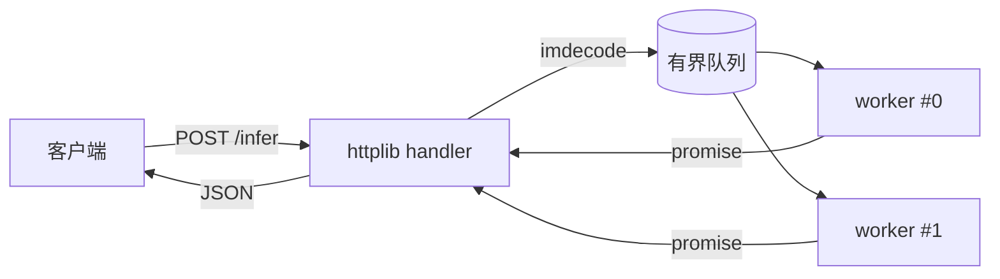

# video-infer-service

用 C++ 写的图像推理服务：HTTP 收图，N 个 TensorRT worker 并行推理，返回 JSON。

技术栈：C++14 / TensorRT 8.6.1 / CUDA 11.4 / OpenCV 4.5 / cpp-httplib / nlohmann-json

写这个服务的出发点是把单张图的推理做成能同时服务多路摄像头的后台。过程中踩了不少坑，下面把结论和对应的数字一起记下来。

## 目前的成绩

- 单机 ~540 FPS（RTX 4060 Laptop，YOLOv8n，4 个 worker，GPU 平均占用 83%）
- 8 路摄像头 × 25fps 同时跑，零错误（每帧 26KB，5GHz 无线链路）
- 压测期间 GPU 平均占用 34.8%，最高 73%——多路场景的瓶颈不在算力

## 结构

```
src/server.cpp    服务端：HTTP + 有界队列 + N 个 TensorRT worker + 显示线程 + 超时/优雅退出
src/client.cpp    客户端：抓帧线程 → 队列（容量 1）→ 发送线程，长连接
src/httplib.h     cpp-httplib 0.67.0
common/           detector / preprocess.cu / postprocess / config.hpp / param
config/           config.yaml：worker 数、端口、engine 路径等全部参数
models/           引擎放这里（*.engine 不进仓库）
```

服务端的处理链路：请求线程 imdecode 解码后塞进有界队列，worker 从中取任务推理，结果用 promise/future 交回请求线程。GPU 只在 worker 线程里被访问。



## 编译和运行

依赖：CUDA 11.4、TensorRT 8.6.1、OpenCV 4.5，以及 nlohmann/json（header-only）。

```bash
mkdir -p build && cd build
cmake -DTRT_ROOT=/path/to/TensorRT ..
make -j$(nproc)
```

客户端的编译不依赖 CUDA 和 TensorRT，只需要 OpenCV。

```bash
# 所有参数都在 config/config.yaml：worker_count、port、engine 路径、阈值等
# 默认 4 个 worker、监听 8000；改参数后重新启动即可，不需要重新编译
./build/server

./build/client 192.168.1.100 8000 0 85    # 服务端 IP、端口、摄像头编号、JPEG 质量
```

服务端启动时读取 `config/config.yaml`，`worker_count` 或 `port` 不合法会打印错误并退出。Ctrl+C 会优雅退出：等在途请求处理完，worker 全部结束后再退出。

## 接口

```bash
curl -X POST -H 'Content-Type: image/jpeg' \
     --data-binary @test.jpg http://127.0.0.1:8000/infer
```

```json
{ "boxes": [ { "cls": 0, "score": 0.959, "x1": 37, "y1": 62, "x2": 924, "y2": 733 } ],
  "ms": 17.3 }
```

| 情况 | 返回 |
|---|---|
| body 为空 | 400 |
| 图片解码失败 | 400 |
| 队列满或被关闭 | 503 / `code:-2` |
| 排队超时（任务取出时已过期） | 504 / `code:-504` |
| 服务端 2s 内没算完 | 504 / `code:-504` |
| 推理内部异常 | 500 / `code:-500` |
| 没带 Content-Type | 413（httplib 的行为） |

每个请求带一个 200ms 的排队期限：任务在队列里等待超过 200ms 就直接丢弃、不再推理，避免积压的过期任务把新请求堵在后面。

## 实测数据

笔记本 GPU 的时钟和系统负载会让批次之间有 ±20% 的抖动，下面取的是多轮中位。

### 单机多 worker（JPEG q80 70.8KB，16 并发，每轮 2400 请求）

| worker 数 | 吞吐 | p50 | p99 | GPU 均值 / 峰值 |
|---|---|---|---|---|
| 1 | 256~270 FPS | 58~61 ms | 64~68 ms | 60% / 81% |
| 2 | 397~402 FPS | 38.0 ms | 47~49 ms | 81% / 98% |
| 3 | 509~525 FPS | 29.2 ms | 35~38 ms | 89% / 100% |
| **4** | **525~551 FPS** | **27.7 ms** | **33~34 ms** | **91% / 100%** |
| 8 | 442 FPS | 30.6 ms | 37 ms | 82% / 100% |

worker 从 1 加到 4 吞吐提升约 2 倍，加到 8 反而下降（CUDA context 与 CPU 争用），所以最终配置是 **4 个**。

并发提高到 32/64 后吞吐仍稳定在 530~540 FPS（队列容量调大后不再出现 503），说明 ~540 FPS 是服务端上限，而不是压测客户端的限制。此时 GPU 平均占用 83%（峰值 100%），剩余约 17% 的空闲来自解码、CPU 后处理等与推理串行的 CPU 阶段。

换用 640×480（25KB，实际摄像头尺寸）复测，峰值吞吐几乎不变（N=4 时 542.6 FPS），但单请求延迟从 10.8 ms 降到 6.5 ms —— 图像尺寸影响延迟，不影响吞吐上限。

### 多路并发（5GHz 无线，每条流严格按 25fps 发送）

| JPEG 质量 | 每帧大小 | 能稳定跑几路 @25fps | 总吞吐 |
|---|---|---|---|
| q95 | 74.6 KB | 2 路（4 路时掉到 19.4fps） | 50 FPS |
| q75 | 26.2 KB | 8 路 @24.2fps，零错误（两次复现） | 194 FPS |

每条流同一时刻只有一个请求在途，所以每路帧率大约是 1000 除以单次请求的往返延迟。25fps 要求延迟低于 40ms，实测 8 路时是 40.3ms，10 路时涨到 45.6ms，帧率掉到 21.2。整个过程中 GPU 平均只有 34.8%，服务端处理时间是 10~27.6ms，所以多路的瓶颈在链路上。

<details>
<summary>其他实测数据</summary>

单次请求的耗时构成：纯 GPU 推理 2.05ms，CPU 后处理约 3.9ms（一次 Run 合计 5.9ms）；imdecode 解 PNG 要 12.95ms，解 JPEG 只要 4.55ms。

质量与体积、吞吐的关系（同一张 640×480 图，16 并发，2400 请求）：

| JPEG 质量 | 体积 | 吞吐 | 客户端 p50 |
|---|---|---|---|
| q30 | 11 KB | 162.5 FPS | 84.7 ms |
| q60 | 19 KB | 100.1 FPS | 146.9 ms |
| q75 | 26 KB | 68.1 FPS | 208.0 ms |
| q85 | 38 KB | 63.4 FPS | 198.7 ms |
| q95 | 75 KB | 31.2 FPS | 493.9 ms |

服务端处理时间全程 10.5~12.2ms 没变，吞吐的差异全部来自传输体积。

</details>

## 已知问题

- CUDA 11.4 不原生支持新架构的卡，第一次推理会触发 PTX JIT，多等 60~80ms，之后恢复正常。
- engine 文件和 TensorRT 版本、GPU 架构绑定，换机器要重新构建。
- `config/config.yaml` 里的 `v8_engine_path` 是绝对路径，换机器要改成实际位置；服务端只从该文件读配置，不解析命令行参数。
- 用 curl 压测时必须加 `-H 'Expect:'`。curl 对超过 1KB 的 POST 会自动加 `Expect: 100-continue`，当前 httplib 版本不能及时回应，会白等一段时间。
- 单张边缘样本上，换 JPEG 质量会让检测结果在置信度阈值附近来回跳，需要用真实的业务图批量验证。

## License

MIT
